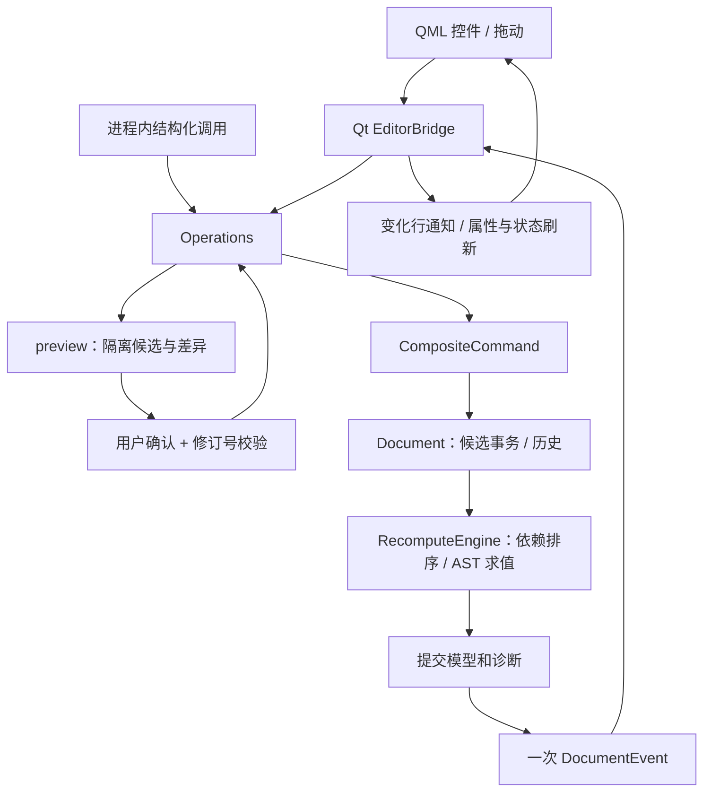

# 文档与属性系统·第四月编辑器架构

本月仍为单文档、单线程、单选、二维矩形。每周核心独立，第四周的控制台和 Qt 窗口链接同一个纯 C++ 静态库。

- **权威模型**：稳定对象 ID、未绑定输入、公式源文本和变量映射。`Document` 持有模型；命令保存值快照，不保存对象指针。撤销/重做会重新计算，分配器高水位不回退。保存基准按内容比较，修订号按成功提交递增，二者用途不同。
- **候选事务**：从正式模型恢复一个候选，先恢复对象/输入，再公式/引用，批量建立依赖后统一检测循环。命令组在一次 batch 内执行，结束时按受影响子图重算。非法命令丢弃整个候选；合法编辑导致的计算失败保留可撤销编辑，后继不能消费旧结果。
- **AST 与诊断**：每文档缓存最多 256 个公式文本的只读树；恢复/撤销复用，变量查询仍读取当前模型。树、图、诊断、计时和历史都不保存到磁盘。核心只使用标准库，Qt 负责转换字符串、范围和界面角色。
- **界面状态**：选择、缩放、平移、拖动预览、公式草稿与请求预览都属于适配层/QML。草稿按对象 ID 和属性键管理；模型刷新不会覆盖草稿。失败的数值输入恢复正式显示；失败公式保留带标记草稿。提交后的事件刷新显示行，仅实际变化对象发送 dataChanged。
- **操作接口**：`query` 返回快照；`preview` 在候选中运行并给出属性级差异；`apply` 校验 expected_revision 并将同一请求编译成组合命令。预览与确认之间如有编辑、撤销或文档替换，旧请求被拒绝。接口不提供任意代码执行、网络端点或 AI 调用。
- **存储**：CAD_DOCUMENT 2 保存权威内容及 ID 高水位；加载失败不替换当前模型。QSaveFile 成功 commit 后才 mark_saved。草稿不能自动保存成正式公式；打开/退出时提示处理未保存文档或草稿。

当前取舍：快照历史易于解释但内存随“历史步数 × 文档规模”增长；候选恢复、语义比较和 Qt 行扫描仍遍历整个文档，属性面板采用整体刷新。适合学习用小模型，大型编辑器应进一步考虑增量候选/历史、变化键通知与缓存摘要。第三周的[性能记录](../week03/performance.md)给出了实际测量，不能只依据增量求值次数判断整条操作链性能。
